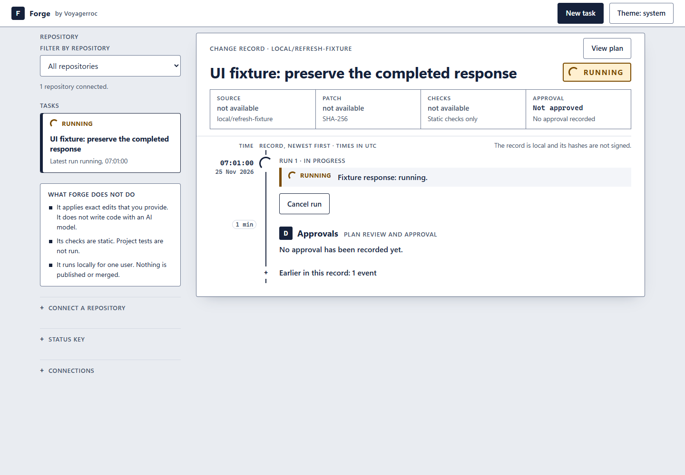
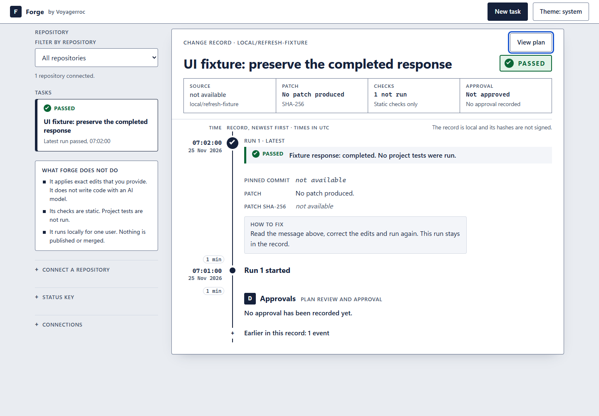
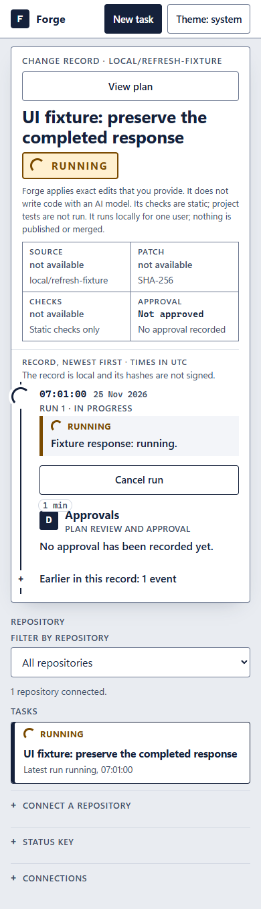
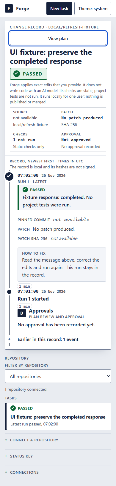

# Forge overlapping refresh: browser evidence

Real Chromium captures of the running public UI, with explicitly synthetic API state. The fixture does not execute a runner, project tests, or source edits, and makes no external API call. No root code branch or PR is changed by this evidence branch.

The actual 1.5-second polling loop receives an initial Running state. Poll 2 is held. Poll 3 returns Passed and the completed record is observed in the browser. Then poll 2 is released with its old Running state. Before the fix, this reverts the record to Running; after the fix, Passed remains visible and `aria-busy` remains false.

The before app.js comes from baseline `28a1e16f2cab409faf64a3475189c5b972acd462`. The after app.js is the final tested source. Other public assets are unchanged. Both versions receive the same synthetic fixture data and response schedule.

| Width | Before | After |
| --- | --- | --- |
| 1440 px |  |  |
| 390 px |  |  |

At both widths, Tab reaches New task, Enter opens the native dialog, Tab/Shift+Tab move focus forwards/backwards, and Escape restores focus to New task. Tab and Enter also open View plan, and Escape restores that trigger. Page and dialog widths stay within the viewport. The after captures retain the visible keyboard focus ring. There were no browser page errors.

These checks verify the UI and out-of-order successful responses. The separate overlapping-failure cases are in the Node regression suite; this capture does not substitute for those tests or prove production isolation.

Browser: `156.0.8078.4`. Capture time: `2026-11-25T07:31:56.927Z`.

Tested source SHA-256:

- `public/app.js`: `7a79e623410eafbd2335d0835faadda1824713977cc784cb9443f926d87b6b05`
- `test/refresh-order.test.mjs`: `ca1386141c7286fd605eba653d515210a3d3e7753f9966a5ba8f6b103ac75885`
- `docs/DEVELOPMENT.md`: `c7faf05cce7270e67445d935a38235d4219b1e2283906928dd79c10b66384429`

Prepared and validated with assistance from OpenAI Codex.
